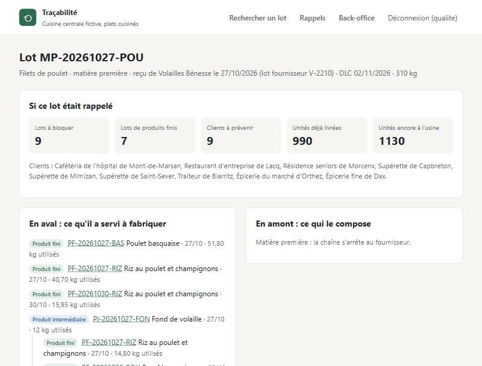
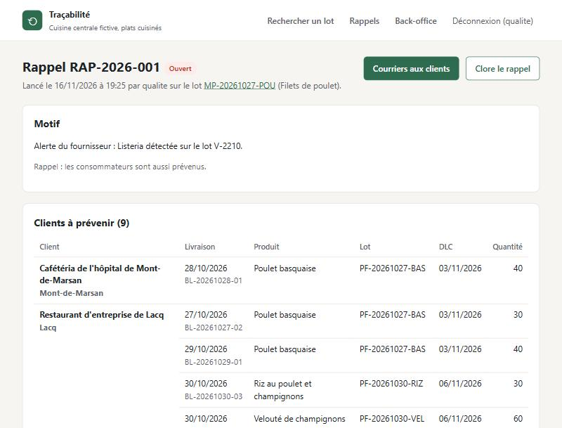

# Rappel de lots

[](https://github.com/brakan1337/rappel-lots/actions/workflows/ci.yml)

Traçabilité et rappel de lots pour une cuisine centrale qui fabrique des plats cuisinés. Quand un fournisseur signale un lot contaminé, le service qualité retrouve en quelques secondes tous les plats concernés et tous les clients à prévenir, bloque les expéditions et imprime les courriers.

**Python 3.12 · Django 6 · Django REST Framework · PostgreSQL · requêtes récursives SQL · pytest · Docker · GitHub Actions**



## Le brief

> Ce projet est un cas d'étude. L'entreprise, ses fournisseurs et ses clients sont fictifs ; le brief sert à justifier les choix techniques.

Une cuisine centrale des Landes reçoit ses matières premières de six fournisseurs, prépare des sauces et des fonds, puis des plats livrés à des cantines, des supérettes et des traiteurs.

Un vendredi soir, le fournisseur de volailles appelle : son lot **V-2210** contient peut-être de la Listeria. Ce poulet est entré dans des plats, mais aussi dans un fond de volaille, lui-même utilisé dans d'autres plats les jours suivants. Avec un tableur, retrouver tout cela prend des heures. La réglementation demande de le faire tout de suite.

**Pourquoi Django :**

- **Le back-office est fourni.** L'administration de Django donne à l'équipe qualité des écrans de saisie, de recherche et de filtre sur les lots, les fournisseurs et les expéditions, sans écrire d'interface.
- **L'équipe data du client travaille déjà en Python.** Elle réutilise le même modèle de données pour ses analyses.
- **L'ORM et les migrations** suivent l'évolution du schéma sans écrire de SQL à la main, sauf là où le SQL est le bon outil (voir plus bas).

## Ce que fait l'application

- **Recherche d'un lot** par numéro interne ou par numéro du fournisseur.
- **Traçabilité aval et amont** : ce que le lot a servi à fabriquer, sur tous les niveaux, et ce qui le compose.
- **Mesure de l'impact avant de décider** : lots à bloquer, clients à prévenir, quantités déjà livrées et encore à l'usine.
- **Lancement du rappel** en un clic : le lot et tout ce qui en descend sont bloqués immédiatement.
- **Courriers aux clients**, un par client, avec les lots, les DLC et les quantités reçues, prêts à imprimer.
- **API pour les entrepôts** : avant de charger un camion, leur logiciel vérifie le lot ; l'API refuse l'expédition d'un lot bloqué.



## Le point technique : la requête récursive

Un lot de poulet entre dans un fond de volaille, qui entre dans un bœuf bourguignon. La chaîne peut avoir autant de niveaux qu'on veut. Plutôt que d'interroger la base niveau par niveau, [`tracage.py`](tracabilite/tracage.py) suit tout le graphe en **une seule requête** :

```sql
WITH RECURSIVE chaine(lot_id, profondeur) AS (
    SELECT CAST(%s AS BIGINT), 0
    UNION ALL
    SELECT c.lot_produit_id, chaine.profondeur + 1
    FROM tracabilite_composition c
    JOIN chaine ON c.lot_utilise_id = chaine.lot_id
    WHERE chaine.profondeur < 20
)
SELECT lot_id, MIN(profondeur) FROM chaine WHERE profondeur > 0 GROUP BY lot_id
```

- La même requête, en inversant les deux colonnes, remonte vers l'amont.
- Le plafond de profondeur protège contre une boucle dans les données : un test en crée une exprès.
- Elle tourne à l'identique sur PostgreSQL et SQLite, et la CI le vérifie sur les deux.

## Le modèle de données

```
Fournisseur ─┐
             ▼
Article ──► Lot ◄──┐            Un lot = une matière reçue, une sauce ou un plat fabriqué.
             │     │ Composition : « ce lot est entré dans celui-là », avec la quantité.
             └─────┘
             │
             ▼
LigneExpedition ──► Expedition ──► Client
             ▲
Rappel ── lots bloqués (tant que le rappel est ouvert)
```

Les règles métier vivent dans le modèle et sont testées :

- une matière première vient forcément d'un fournisseur, un lot fabriqué jamais ;
- un lot ne peut pas servir avant d'avoir été reçu ou fabriqué ;
- on n'expédie que des produits finis, et jamais un lot bloqué ;
- la base elle-même refuse un lot composé de lui-même ;
- clore un rappel débloque ses lots, sauf ceux qu'un autre rappel ouvert retient encore.

## L'API des entrepôts

Authentification par jeton : `Authorization: Token <jeton>`.

| Méthode | Adresse | Rôle |
|---|---|---|
| `GET` | `/api/lots/{numero}/` | le lot, et s'il est bloqué |
| `GET` | `/api/lots/bloques/` | la liste à jour des lots interdits d'expédition |
| `GET` | `/api/lots/{numero}/aval/` | ce que le lot a servi à fabriquer |
| `GET` | `/api/lots/{numero}/amont/` | ce qui compose le lot |
| `GET` | `/api/rappels/?statut=ouvert` | les rappels |
| `GET` | `/api/rappels/{numero}/` | un rappel et les clients à prévenir |
| `POST` | `/api/expeditions/` | déclarer une expédition (refusée si un lot est bloqué) |

```bash
curl -X POST localhost:8000/api/expeditions/ -H "Authorization: Token <jeton>" -H "Content-Type: application/json" \
  -d '{"numero":"BL-1","client":"Traiteur de Biarritz","date":"2026-11-16","lignes":[{"lot":"PF-20261029-VEL","quantite":"10"}]}'
```

```json
{"lignes": {"0": {"lot": ["Le lot PF-20261029-VEL est bloqué par un rappel en cours."]}}}
```

## Lancer le projet

**En local**, avec Python 3.12 :

```bash
python -m venv .venv
```

```bash
.venv/bin/pip install -r requirements-dev.txt
```

```bash
.venv/bin/python manage.py migrate && .venv/bin/python manage.py charger_demo
```

```bash
.venv/bin/python manage.py runserver
```

Sous Windows, remplacez `.venv/bin/` par `.venv\Scripts\`.

Puis http://localhost:8000, avec le compte de démonstration **qualite** / **demo-qualite**. La commande `charger_demo` affiche aussi le jeton d'API de l'entrepôt.

**Avec Docker** (PostgreSQL compris) :

```bash
docker compose up --build -d
```

```bash
docker compose exec app python manage.py charger_demo
```

Les données de démonstration couvrent un mois d'activité : 262 lots, 663 liens de composition et 165 expéditions. Le tirage est déterministe : chaque chargement donne les mêmes données. Pour rejouer le scénario, cherchez **V-2210**.

## Tests

```bash
pytest
```

- **Traçabilité** : 10 tests (aval et amont sur plusieurs niveaux, boucle dans les données, impact, numérotation, blocage et déblocage).
- **Modèle** : 8 tests sur les règles métier et les contraintes de la base.
- **API** : 9 tests (authentification, expédition acceptée puis refusée, lots bloqués).
- **Pages** : 9 tests (connexion obligatoire, permissions, lancement du rappel, courriers, back-office, données de démo).

La CI vérifie le style (ruff), les migrations oubliées, rejoue les 36 tests sur SQLite puis sur PostgreSQL, et construit l'image Docker.
